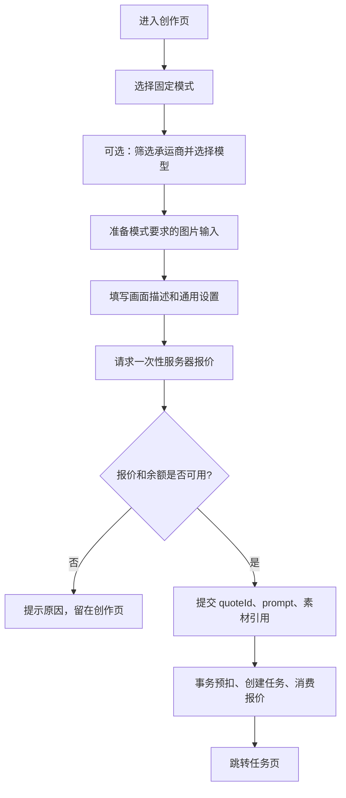

# 创作 · 页面流程

路由：`/app/create`  
组件：`frontend/src/pages/client/CreatePage.vue`

---

## 页面职责

按固定创作模式准备输入、选择可见的承运商和模型、取得服务器报价并创建一次视频生成任务。页面不展示供应商、采购成本、上游工作流或路由信息。

不在此页查看任务进度、管理作品目录或充值；余额不足时提示用户前往钱包。

## 三种固定模式

| 模式 | 必填输入 | 素材槽 |
| --- | --- | --- |
| 文生视频 | 画面描述 | 无 |
| 首尾帧生成视频 | 画面描述、首帧、尾帧 | 首帧与尾帧均必填 |
| 多图生成视频 | 画面描述、至少一张参考图 | 最多张数由当前模型供给返回 |

这三个模式是产品合同，不会随供应商工作流增减。首尾帧和多图是两个独立模式，不保留“图生视频”父模式或额外参考图分支。

## 页面区块

1. 页头：创作标题与钱包余额。
2. 模式工具栏：文生视频、首尾帧生成视频、多图生成视频。
3. 素材区：仅在两个图片模式下显示，支持上传或从当前作品资产中选择。
4. 通用设置：承运商筛选、模型选择、画幅比例、视频时长、输出分辨率、模型自动生成音频。
5. 描述与提交：填写 prompt，服务端报价后预扣并创建任务。

承运商和模型均可不选，表示“智能推荐”。选择承运商仅筛选该原厂下可用于当前模式的模型；选择具体模型后，服务端不得改用其他模型。自动音频只代表模型自动生成音频，不支持参考音频上传；没有对应能力和价格规则时不显示开关。

时长、分辨率、画幅和自动音频均从 `GET /api/v1/client/create/options` 返回。前端不能把 10 秒、1080P、15 秒、768P 或音频开关写成所有模型都可用的固定值。

## 用户流程



提交前会先上传本地选择的图片，或保留当前作品中的资产引用。请求报价时传入模式、可选模型、时长、分辨率、画幅和自动音频；创建任务时只提交 `quoteId`、标题、prompt 和素材引用。客户端不能提交价格、供应商、路由、工作流 ID、时长或分辨率快照。

## 草稿

没有显式“保存草稿”按钮，但会在本机静默保存模式、素材位、描述和通用设置。广场带入的 `draftPrompt` 优先于已保存描述；提交成功后清理草稿。文件内容不写入 localStorage，素材只保存资产 ID 或已上传状态。

## 与其他页面的关系

```text
广场 ──描述──► 创作 ──报价/提交──► 任务 ──保存──► 资产
                  │
                  ├─ 从当前作品选择图片
                  └─ 预扣/失败退款 ──► 钱包流水
```

## 当前边界

- 供应商正式凭据、对象存储和上游能力需在管理端配置后才能真实执行；无可用组合时创作端只显示可报价能力。
- 参考音频、实际输出时长结算和其他多模态能力不属于本期三个模式。
- 失败任务需要回到创作页重新配置并获取新报价，不能复用旧任务或旧报价。

详细接口字段见 [客户端创作 API](../api/client-create.md)，领域和路由规则见 [创作模式与供应商路由设计](../创作模式与供应商路由设计.md)。
