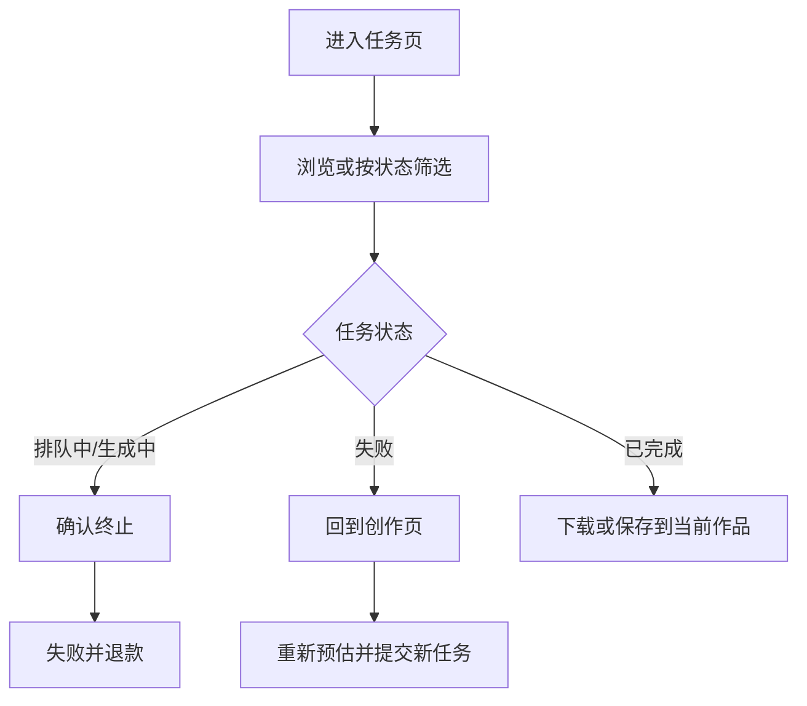

# 任务 · 页面流程

路由：`/app/works`  
组件：`frontend/src/pages/client/WorksPage.vue`  
侧栏菜单名：任务

---

## 页面职责

查看和管理视频生成任务的排队、生成、完成和失败状态。用户可终止未完成任务、下载或保存完成结果；失败任务的“重新生成”会回到创作页，以新参数重新预估并创建新任务。

客户端仅显示创作模式、可见承运商/模型、参数、状态和实际支付金额。供应商、采购成本、上游任务 ID、路由和工作流 ID 不对创作者展示。

## 页面组成

1. 页头：任务标题与“新建创作”。
2. 状态筛选：全部、排队中、生成中、已完成、失败。
3. 任务列表：桌面表格、移动端卡片；展示标题、ID、创作模式、状态、分辨率、时长、费用和时间。
4. 分页：每页 10 条。

## 状态和操作

| 状态 | 操作 | 结果 |
| --- | --- | --- |
| 排队中 / 生成中 | 终止任务并退款 | 状态变为失败，已预扣金额全额退回钱包 |
| 失败 | 重新生成 | 跳转创作页，重新选择参数并获取费用预估后提交新任务 |
| 已完成 | 下载结果 | 获取实际成片或签名下载地址 |
| 已完成 | 保存到当前作品 | 写入当前作品的 `视频 / 正片镜头` |

上游终态失败也由服务端自动全额退款。退款只记一次钱包流水；成功任务不会因后续价格或供给变化重新扣款或重新路由。

## 用户流程



## 计费关系

```text
创作页完整参数提交
  -> 重新路由并锁定钱包
  -> 预扣、订单、任务消费流水、创建任务快照

上游失败或用户终止
  -> 失败、任务退款流水、全额退款

失败后重新生成
  -> 新参数、新任务、新预扣；不复用旧任务
```

## 当前边界

- 任务详情页已通过 `/app/works/:id` 和 `GET /client/tasks/:id` 提供用户安全参数与交付状态；列表和详情均不暴露供应商内部信息。
- 下载仅使用对象存储持久化交付地址；上游 URL 不返回客户端。对象存储未完成时显示等待交付，Worker 会在存储恢复后继续持久化，不展示模拟下载。
- 保存位置目前固定为当前作品的 `视频 / 正片镜头`，页面不提供子目录选择。

创作的输入和报价规则见 [创作页面流程](./client-create.md) 与 [创作模式与供应商路由设计](../创作模式与供应商路由设计.md)。
