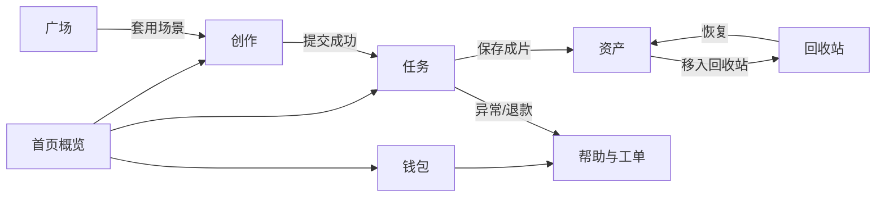
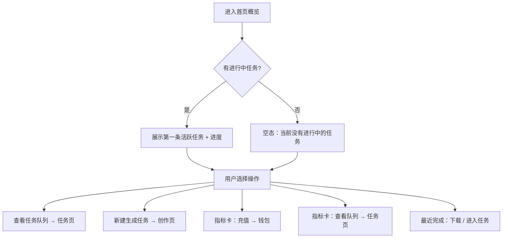
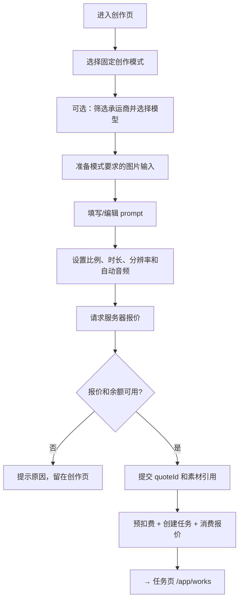
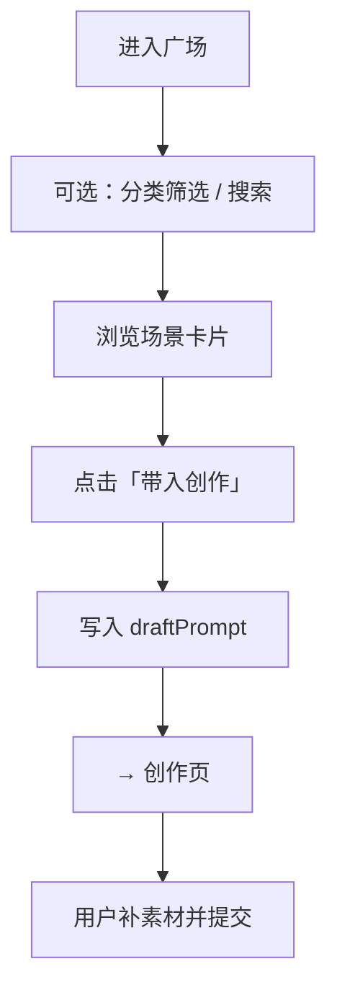
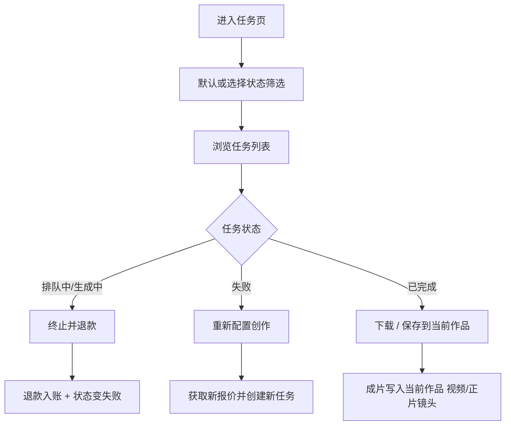
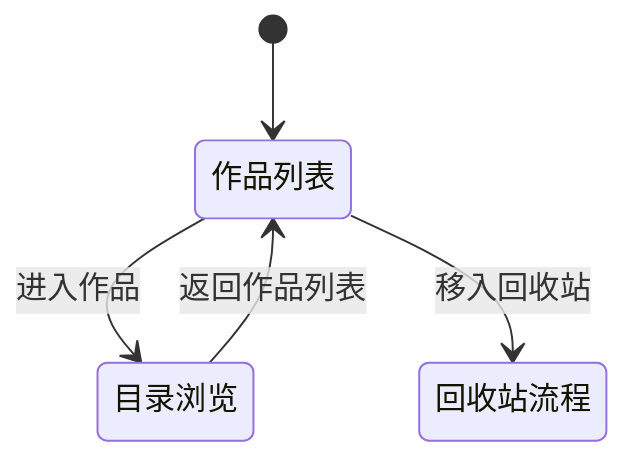
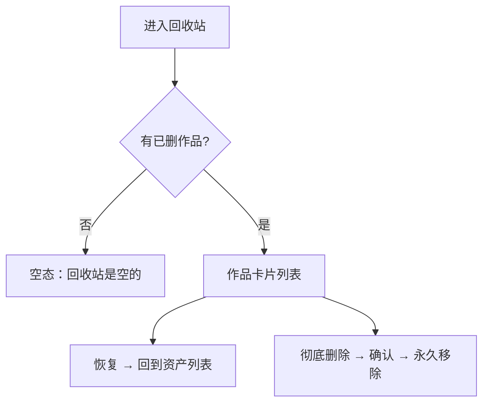
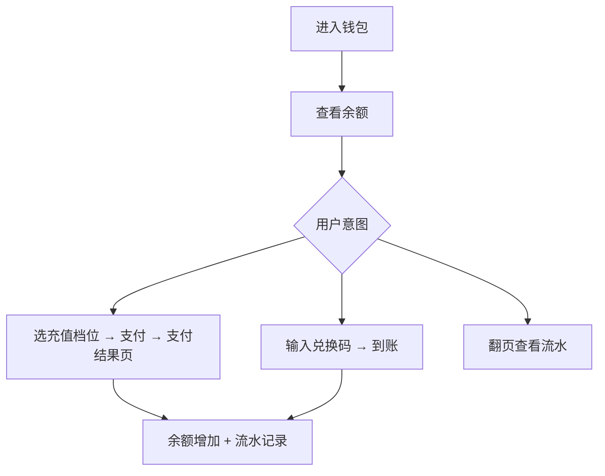
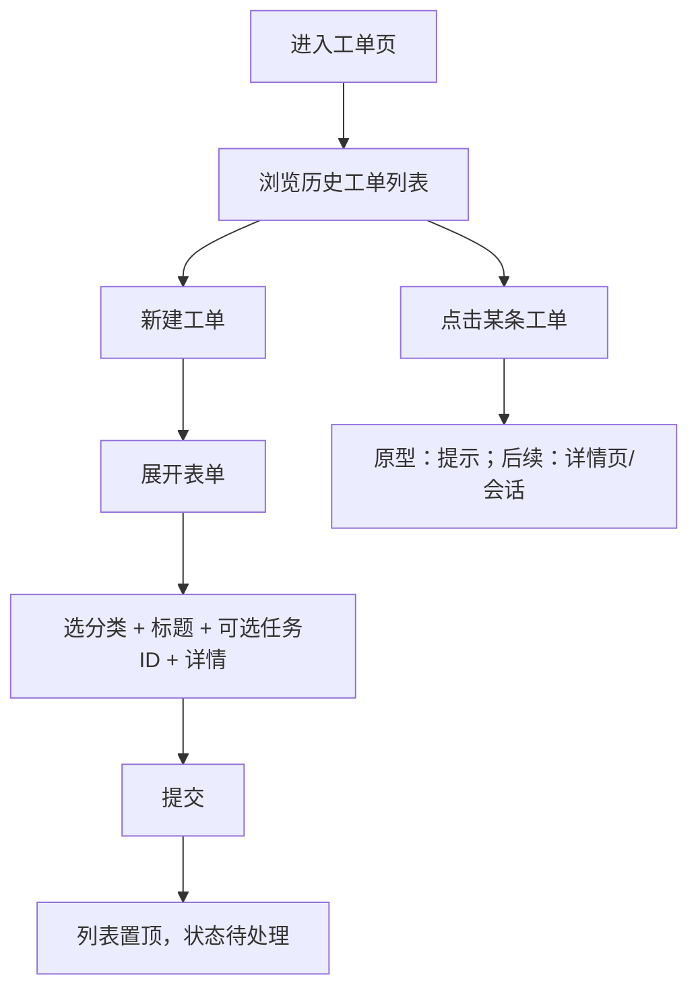
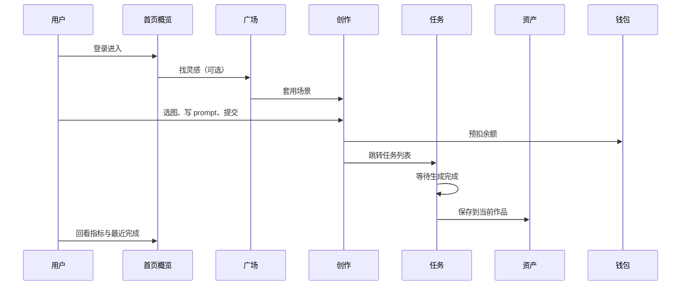

# 客户端页面流程

路由前缀 `/app`。个人资料在顶栏头像，不在侧栏。

## 全局导航关系



---

## 1. 首页概览 `/app/overview`

### 定位

登录后默认页。**只看状态、快速跳转**，不在此页编辑或配置。

### 进入方式

- 登录成功默认落地
- 侧栏「首页概览」
- 顶栏 Logo

### 页面分区

```text
┌─ 页头 ─────────────────────────────────────────┐
│ 欢迎回来，{工作室名}    [查看任务队列] [新建生成任务] │
├─ 指标卡 ×5 ────────────────────────────────────┤
│ 累计支出 | 可用余额 | 秒价 | 空间占用 | 进行中任务数 │
├─ 进行中任务（单条或空态）──────────────────────┤
├─ 最近完成任务（最多 2 条卡片）─────────────────┤
└──────────────────────────────────────────────┘
```

### 主流程



### 操作与跳转

| 用户操作 | 结果 |
| --- | --- |
| 查看任务队列 | → `/app/works` |
| 新建生成任务 | → `/app/create` |
| 可用余额卡「立即充值」 | → `/app/wallet` |
| 进行中任务卡「查看全部」 | → `/app/works` |
| 最近完成「进入任务」 | → `/app/works` |
| 最近完成「下载」 | 下载该任务成片（原型为提示） |

### 空态与边界

- **无进行中任务**：中间区块显示空态文案，指标卡「进行中任务」仍显示 `0`。
- **无最近完成**：下方列表为空（当前 mock 总有已完成任务）。
- **不在此页**：创建任务、上传素材、管理作品文件。

### 与全站关系

- 侧栏「任务」角标数字 = 进行中 + 排队中，与指标卡「进行中任务」一致。
- 顶栏余额与「可用余额」卡同源。

---

## 2. 创作 `/app/create`

### 定位

配置一次视频生成并提交；提交后进入任务队列。

### 进入方式

- 侧栏「创作」
- 首页 / 任务页「新建创作」
- 广场「套用场景」（预填画面描述）

### 页面分区

```text
固定模式：文生视频 / 首尾帧生成视频 / 多图生成视频
├─ 模式对应输入素材 + 画面描述
└─ 通用设置（承运商、模型、比例、时长、分辨率、自动音频、报价、提交）
```

### 主流程



### 分支

| 分支 | 说明 |
| --- | --- |
| 从广场带入 | `prompt` 已预填，用户可再编辑 |
| 从资产选图 | 仅当前作品的图片；无图时提示 |
| 上传图片 | 上传首尾帧或多图参考；提交前服务端校验素材归属 |
| 余额不足 | Toast 提示，不跳转 |

### 不在此页完成

- 查看任务进度（去任务页）
- 管理作品目录（去资产页）

---

## 3. 广场 `/app/garden`

### 定位

浏览官方场景模板，**只负责激发灵感并带到创作页**，不提交任务。

### 主流程



### 操作与跳转

| 操作 | 结果 |
| --- | --- |
| 分类切换 | 列表过滤，停留本页 |
| 搜索 | 按标题/描述过滤 |
| 套用场景 | → `/app/create`，prompt 已填 |

---

## 4. 任务 `/app/works`

### 定位

全部生成任务的生命周期管理：排队、进行中、完成、失败。

### 进入方式

- 侧栏「任务」（带进行中数量角标）
- 首页「查看任务队列」
- 创作提交成功后跳转

### 页面分区

```text
页头 + [新建创作]
状态分段：全部 | 排队中 | 生成中 | 已完成 | 失败  （按状态筛选）
任务列表（桌面表格 / 移动卡片）
分页
```

### 主流程



### 操作说明

| 状态 | 可用操作 |
| --- | --- |
| 排队中 / 生成中 | 终止并退款（确认弹窗） |
| 失败 | 重新配置创作 |
| 已完成 | 下载、保存到当前作品、查看详情 |
| 全部 | 查看详情 |

**筛选说明**：顶部分段即筛选条件（按任务状态），无额外「筛选」按钮。

### 跳转

| 操作 | 目标 |
| --- | --- |
| 新建创作 | → `/app/create` |
| 保存到作品成功 | 文件在 `/app/assets` 当前作品下 |

---

## 5. 资产 `/app/assets`

### 定位

以**作品**为单位的工程文件管理；每个作品是一套固定目录模板。

### 两种页面状态



### 作品列表态

```text
存储空间条
[新建作品] → 输入名称 → 按模板创建 → 自动进入该作品目录
作品卡片：进入 | 移入回收站
```

| 操作 | 结果 |
| --- | --- |
| 新建作品 | 创建标准模板工程 → 进入目录浏览 |
| 进入作品 | 切换当前作品 → 目录浏览 |
| 移入回收站 | 确认 → 作品进回收站，回到列表 |

### 目录浏览态

```text
面包屑：{作品名} / 资产 / 人物 / …
[返回作品列表] [上传素材]
网格或列表：子文件夹 + 文件
当前目录内搜索
```

| 操作 | 结果 |
| --- | --- |
| 点击文件夹 | 进入子目录 |
| 面包屑 | 跳转到对应层级 |
| 上传素材 | 写入当前目录（默认 资产/素材） |
| 删除文件 | 从当前作品移除该文件 |

### 固定目录（不可删）

```text
资产/人物、场景、道具、素材
视频/正片镜头（默认成片目录）
```

### 与任务的关系

- 创作页「从资产选择」→ 读**当前作品**下的图片
- 任务页「保存到当前作品」→ 写入 **视频/正片镜头/**

---

## 6. 回收站 `/app/trash`

### 定位

已移出作品的暂存区；可恢复或彻底删除。

### 主流程



| 操作 | 结果 |
| --- | --- |
| 恢复 | 作品回到资产页列表 |
| 彻底删除 | 不可恢复，侧栏回收站角标减 1 |

**入口**：仅能从资产页「移入回收站」进入此流程，资产页不能直接永久删除。

---

## 7. 钱包 `/app/wallet`

### 定位

充值、兑换、查流水；任务扣费/退款会体现在流水中。

### 主流程



| 区块 | 操作 |
| --- | --- |
| 充值余额 | 选档位 → 立即充值 → `/auth/payment-result` |
| 兑换余额 | 输入码 → 确认兑换 |
| 余额流水 | 分页浏览；点击了解扣费规则为说明弹层 |

### 与创作闭环

- 创作提交 → 预扣 → 流水「任务消费」
- 任务终止/失败退款 → 流水「任务退款」

---

## 8. 帮助与工单 `/app/tickets`

### 定位

问题反馈与售后；可关联任务 ID。

### 主流程



| 分类 | 典型场景 |
| --- | --- |
| 售后支持 | 退款咨询 |
| 生成异常 | 黑屏、失败 |
| 售前咨询 | 功能、分辨率开放时间 |
| 充值问题 | 到账、支付 |

侧栏角标 = 未解决工单数（非「已解决」）。

---

## 9. 个人资料 `/app/profile`（非侧栏）

### 进入

顶栏头像 → 个人资料

### 职责（概要）

账号信息、通知偏好、登录设备、退出登录。不参与创作主链路，此处不展开。

---

## 端到端闭环（创作者典型一天）



---

## 待产品补全的流程缺口

| 页面 | 缺口 |
| --- | --- |
| 首页概览 | 产品文案含「灵感入口」，页面尚无直达广场入口 |
| 任务 | 「查看详情」尚无独立详情页 |
| 工单 | 列表点击尚无详情/回复流 |
| 创作 | 参考音频、实际时长结算等新输入合同尚未开放 |
