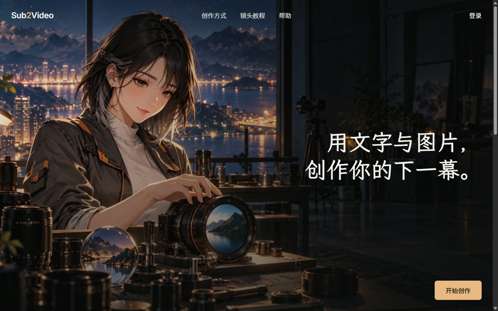

# 官网右侧构图与字体统一：实现、回归及 107 发布

## 结果与范围

2026-10-09，按用户要求删除首页播放/暂停/重试背景控制，将「开始创作」移至首屏右下并删除箭头，将双行主标题移动至右侧。公共官网 H1/H2 使用艺术字体，导航、正文和操作统一使用阅读字体。已发布到 http://192.168.0.107:12000/。

UI/UX 与 Vue/Vue testing 技能用于确定标题/阅读字体分工、响应式安全距离、生命周期与真实媒体行为测试；保留项目设计系统、Vue 3 和现有组件所有权。未重做产品工作区或认证页面。

## 本轮修改

- `frontend/src/features/guides/ProductHome.vue`：标题与独立 CTA；删除箭头。
- `frontend/src/features/guides/ProductHeroFilm.vue`：删除控制及相关提示；延后自动播放，离屏/隐藏暂停，恢复时按偏好播放；区分 AbortError 中断和真正失败，避免失败后的反复请求。
- `frontend/src/features/guides/home.css`：右侧双行标题、右下按钮、克制的对比遮罩、窄屏与短屏位置。
- `frontend/src/features/guides/guides.css`：公共 H1/H2 和阅读字体统一。
- `frontend/src/shared/styles/tokens.css`：字体声明和两个语义字体变量，不改变工作区/认证正文配方。
- `frontend/public/fonts/s2v-public-display-medium.woff2` 及对应 OFL、ATTRIBUTION：LXGW WenKai Medium v1.522 的本地 WOFF2 子集，实际 weight 500；502 映射字形，102,860 bytes。完整版权/许可保留，派生字体元数据已重命名。
- `docs/ui/design-system.md`：将本轮确认的构图、字体和首页播放规则纳入现有规范。
- `frontend/tests/e2e/public-home.contract.spec.ts`、`full-background.contract.spec.ts`：无背景控制/箭头、位置、加载字体、短屏、媒体失败、节流、真实本地 MP4、离屏暂停和恢复。
- `frontend/tests/e2e/journey.visual.spec.ts`：公共页面精确视觉比较，避免 2% 容差忽略文字或按钮位置。
- 六张人工审阅后的视觉基线：journey-product-home 的 desktop/mobile、journey-guide-detail 的 desktop/mobile，以及 responsive-home 的 390/1920 desktop。
- 本记录与 `homepage-art-107-2026-10-09/desktop.jpg`、`mobile.jpg`：实际已发布页面截图，扩展名与浏览器返回的 JPEG 编码一致。

保留所有既有工作区修改；上述清单仅为本轮触及的文件，不等同于整个 Git dirty 状态。

## 构建与版本

- 分支：`codex/commercial-studio-redesign`。
- HEAD：`0cafa8d612f4ad8dcebcff58d7d25d674ebd5945`，含未提交工作区修改。
- Node v22.16.0；pnpm 10.32.0；Vite 6.4.3；Playwright 1.62.1。
- 构建：`pnpm --dir frontend build --outDir ../.tmp_home_art_20261009_01/dist`。
- 174 项构建输入在构建前后完全一致。相对上一轮已发布源码仅 8 项变化：五个应用文件、三个字体/许可文件。其他产品功能输入无变化。
- 产物：137 文件，归档 142 项，仅普通文件/目录，无链接、穿越路径或凭据。
- 归档元数据规范为目录 0755 / 文件 0644，避免 Windows tar 默认可写权限带到新发布资源。
- 归档 SHA-256：`97db2fecbb92f85e1002bc50af5939c2a3fa13b827e1b303393dc43515f302ce`。
- index SHA-256：`ec96d0ac059a5d58b1f270edd1a70ac555e5311393c6cdd97711613ef9d25c85`。
- source manifest SHA-256：`daad55659854b4e129c0568bd1334a52b3c2c841c995f128c36a5031f03ff8dd`。
- 字体 SHA-256：`9f830a0fa09c9ab602ca804ccdd58f62ec1cee81354801d94a67d097a8bfc238`。
- entry JS：`/assets/index-fRg6XjUV.js`。

## 验证

| 检查 | 结果 | 证据边界 |
| --- | --- | --- |
| `pnpm lint:check` | 通过 | 前端静态规则；最终修改后再次通过 |
| `pnpm typecheck` | 通过 | Vue/TypeScript；构建时也通过 |
| `pnpm build`（隔离 outDir） | 通过 | 当前 dirty 源码产物，不覆盖旧构建 |
| public-home / full-background 合同 | 137 passed，7 skipped | 跳过的是 mobile project 中重复的七宽度矩阵；Mock/API 路由，媒体合同另含真实本地 MP4 |
| 选定响应式/视觉基线更新 | 10 passed，6 duplicate skips；公共精确比较补充 4 passed | 仅上述六张预期变化，已人工审图；没有增加容差 |
| `pnpm test:visual --reporter=line` 最终全量 | 460 passed，36 skipped，3.3m | Mock 交互、几何、视觉与本地视频行为；跳过重复 mobile project 尺寸矩阵；不证明后端交易或供应商执行 |
| `git diff --check` | 通过 | 整体工作区；没有暂存/清理现有改动 |
| 107 SSH / 文件校验 | 通过 | 激活前逐文件验包；激活后137项新文件、1274项旧 hashed assets均匹配 |
| 107 内置浏览器 | 通过 | 当前资源、真实字体、真实背景视频、响应式几何、模式切换、CTA 登录回跳 |

初次全量回归因发现原 2% 容差会接受旧桌面标题/按钮而主动中断；收紧公共页面比较并审阅新基线后，执行了上述完整最终回归。中断记录未计入通过结果。

本轮没有后端改动，没有执行 Go/数据库/供应商验收，也未创建付费任务。

## 107 实页证据

艺术字体的 FontFace 已 `loaded`、weight `500`；H1 首族 `S2V Public Display`，CTA 首族 `Source Han Sans SC`。主按钮不含 SVG，首页背景按钮数量为 0。桌面 video `muted=true`、`paused=false`、readyState 4，实际播放时间已推进至 3.734036s。滚动至创作方式后，video `paused=true`。390px 刷新后 video 元素数量为0，海报显示正常。

| 实际浏览器宽度 | 高度 | 横向溢出 | 标题/CTA右轴差 | CTA距首屏底部 | 标题与CTA间距 |
| --- | --- | --- | --- | --- | --- |
| 320 | 844 | 0 | 0 | 24 | 84 |
| 390 | 844 | 0 | 0 | 24 | 84 |
| 768 | 900 | 0 | 0 | 32 | 298 |
| 1024 | 900 | 0 | 0 | 32 | 282 |
| 1440 | 900 | 0 | 0 | 32 | 282 |
| 1920 | 900 | 0 | 0 | 32 | 272 |

所有标题为右对齐，主 CTA 无箭头。另有本地合同覆盖2560px、320/305px可用宽度和480px短屏。

真实点击文生/首尾帧/多图切换，内容及 mode-specific 链接正常；点击「开始创作」进入 `/auth/login?redirect=/app/create&reason=session-expired`，保留创作目的地，现有浏览器过期会话被正常提示。没有输入密码、执行登录或新生成。认证页的现有暂停控件保留，本轮移除仅限官网。

六个入口 `/`、`/guides/coast-letter`、`/auth/login`、`/auth/register`、`/app/create`、`/admin` 均提供候选 index 摘要。字体通过服务器实际HTTP返回与本地产物摘要一致。视频 Range 返回206、MIME `video/mp4`、1024 bytes，Content-Range总大小2,064,807 bytes。公开设置返回JSON 200，用时0.003269s；这一单次响应不构成持续负载性能结论。

## 发布、备份与数据边界

- 仅前端完整产物发布，复用 `deploy/update-107-frontend.sh`，校验包、部署锁、旧 hashed assets 保留、Nginx检查与 reload。
- release：`/opt/sub2video/releases/homepage-art-20261009-01/`；包含候选、摘要清单、137项激活前验证、激活后验证和 Nginx 配置副本。
- 原前端备份：`/opt/sub2video/frontend/.dist-pre-20261010031304-1262152/`，index 为 `9c53d78b2d309513d06eced959eaea98816bd1fa445b9c9a7d184613ffd466f5`，已验证。
- 新 dist 根目录0755。入口校验失败由既有脚本恢复旧 dist，并保留新 hashed assets；外层逐文件/业务检查失败需根据原因人工评估，不宣称全部验收失败都会自动回滚。
- 后端 PID4131与 SHA `adc728bf714a33d900b4fed21bfa46f95edd83a99a09559629df0ffeaa8f58e7` 均未变。
- Nginx site SHA `c6cd9dc6d3b7061f969d2181020b63d5666dabfc69ecec8055734bb409a1a81d` 未变；没有配置修改、数据库迁移、任务、订单、余额或资产写入。
- 未 Git commit、未 Git push；部署成功，无实际回滚。

## 风险、清理与下一步

无本轮发布阻塞。官网持续动画已按用户要求删除暂停入口；保留系统减少动态/节省流量偏好和离屏暂停，不宣称满足所有持续动画暂停控制的可访问性条款。艺术字体是子集，未来新增官网标题应补充字形再审阅视觉基线。

本轮临时目录：`E:\apps\github.com\sbu2video\.tmp_home_art_20261009_01`，用于字体生成、候选构建和临时日志。以前的 `.tmp_home_implementation_20261009_01`、`.tmp_home_release_20261009_01` 未清理。本轮目录的最终清理结果见本记录末尾；远端 release 与旧前端备份按发布恢复需要保留。

下一步：由用户查看107的实际桌面/手机首页，确认右侧构图与艺术字风格，再决定是否继续调整内容层次。

最终清理结果：自动审批策略以 `blocked by policy` 拒绝了对本轮独立临时目录的 `Remove-Item -Recurse -Force`。没有执行删除，也没有采用绕过方式；该目录仍完整保留，用户可自行清理，不影响页面运行。先前临时目录和远端恢复资料均保留。
