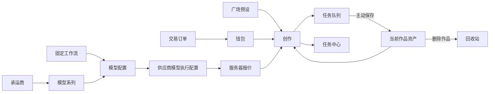

# Sub2Video H3 MVP 信息架构

完整菜单和实施顺序以 [`docs/产品方案总览.md`](../产品方案总览.md) 为准；本文件补充原型页面的信息职责。`sub2video-client.html` 与 `sub2video-admin.html` 只约束视觉配方；HTML 侧栏里的「创作台 / 作品集」不要搬进 Vue。

## 产品边界

Sub2Video 是面向创作者的视频生成产品，不是 API 聚合或账号分发平台。

- 客户端只服务个人创作闭环：找灵感、创建任务、查看结果、保存复用内容、支付。
- 管理端只服务平台运营闭环：配置可售能力、保证供应、管理交易和任务、处理用户与系统治理。
- 供应商 API Key、渠道余额、对象存储路径和调度细节只存在于管理端与后端，不进入客户端。

## 客户端

| 菜单 | 用户要完成的事 | 收纳内容 | 不收纳内容 |
| --- | --- | --- | --- |
| 创作 | 发起一次视频生成 | 工作流选择、输入素材、提示词、生成参数、价格确认 | 全部历史任务、长期文件管理 |
| 广场 | 找到可套用的创作起点 | 官方场景、预设提示词、示例效果、分类筛选 | 用户私有素材、供应商模型配置 |
| 任务 | 跟进已发起的生成 | 排队、生成中、失败、已完成结果、下载、重试、保存到当前作品 | 长期素材库 |
| 资产 | 按作品工程管理文件 | 作品列表、标准目录（人物/场景/道具/素材 + 视频）、上传与浏览 | 渲染队列、已删除作品 |
| 回收站 | 处理被移出的作品 | 恢复作品；永久删除只发生在这里 | 单个素材的日常管理 |
| 钱包 | 充值和核对支出 | 余额、充值、兑换、充值订单、余额流水 | 订阅、API Key、模型套餐 |

`创作`放在首位，因为视频生成是核心动作；`任务`在`资产`之前，让用户先处理刚生成的结果，再决定是否保存进作品工程。作品从资产页只能丢进回收站。

客户端固定为文生视频、首尾帧生成视频和多图生成视频。每种模式实际可用的模型、时长、分辨率、画幅和自动音频能力以创作目录与报价为准，不能把 `768P / 15 秒` 或某个模型写成硬编码产品限制。

## 管理端

| 分组 | 菜单 | 职责 |
| --- | --- | --- |
| 首页概览 | 首页概览 | 看任务量、收入、成功率、异常和供应状态；不在这里做配置。 |
| 创作管理 | 工作流 | 维护三个固定模式的上架状态、展示和排序；不新增第四种模式，也不绑定模型或上游调用。 |
| 创作管理 | 承运商与模型 | 维护模型原厂、模型系列，以及模型对固定工作流的支持、推荐顺序、默认参数和对客售价。 |
| 创作管理 | 供应商与模型 | 维护供应商调用地址和凭据，并把既有模型配置绑定为可执行供给，配置上游工作流、实际能力、健康状态和采购成本。 |
| 计费管理 | 价格审计 | 只读核对工作流 × 模型 × 分辨率 × 自动音频的售价与版本；售价在模型配置编辑，成本在供应商执行配置编辑。 |
| 任务管理 | 任务中心 | 查询、取消、退款和处理生成异常。风险任务与内容审核成熟后在本分组增加。 |
| 运营管理 | 工单中心 | 处理退款、生成异常和售前咨询，并关联任务与金额。 |
| 运营管理 | 公告 | 发布价格、服务状态和规则变更。 |
| 系统 | 运维监控 | 查看供应商健康、队列、失败率、延迟和资源状态。 |
| 系统 | 操作日志 | 审计管理员对任务、定价、创作模式、承运商/模型和供应商供给做的操作，属于治理而非任务处理。 |
| 系统 | 系统设置 | 管理存储留存、通知、服务基础策略和系统级开关。 |

`场景模板`将来加在“创作管理”，因为它控制的是广场和创作端的展示与预设；H3 MVP 尚未支持运营配置时不在主菜单展示。`内容审核 / 风险任务`同理，供应链和审核策略具备后再加在“任务管理”。

## 核心流转

## 存储口径

- 任务输入：默认短期保留，例如 7 天。
- 生成结果：默认在任务队列中保留，例如 30 天。
- 资产：用户主动保存进作品工程才计入个人逻辑额度，按产品策略保留。作品删除只进回收站。
- 对象存储由平台统一管理；客户端展示“资产额度”和“有效期”，不展示 OSS、Bucket 或供应商概念。
